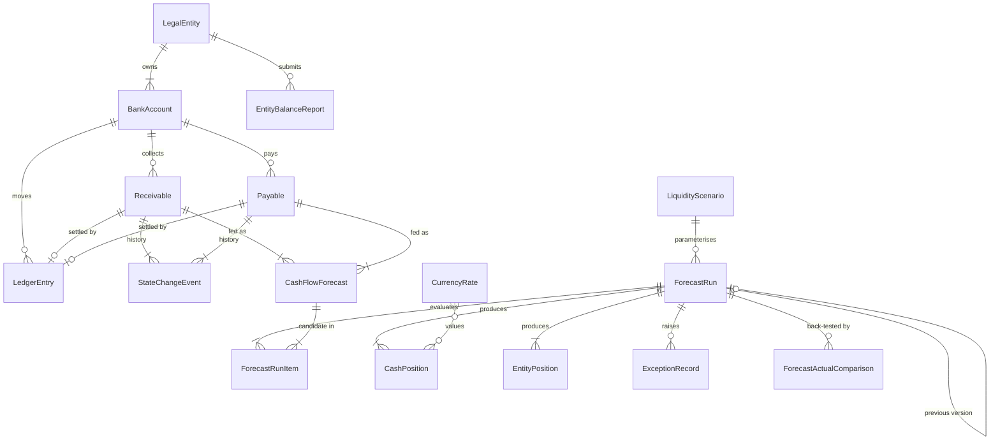

# Schema and relationships

Field-level types, required flags, allowed values and formats are in [data_dictionary.md](data_dictionary.md) (generated
from `schema.py`). `data/generated/schema.sql` contains the DDL with every primary and foreign key, and
`seed_data.sql.gz` uses standard SQL types and loads into SQLite with foreign keys enforced (covered by a test).



## Cardinality

| Parent | Cardinality | Child | Notes |
|---|---|---|---|
| LegalEntity | 1:N (≥1) | BankAccount | Account ID embeds the entity ID; account `effective_from` ≥ entity `effective_from` |
| BankAccount | 1:N | LedgerEntry, Receivable, Payable | Child `entity_id` and currency must equal the account's |
| Receivable / Payable | 1:0..1 | LedgerEntry | Only settled items have a settlement entry (`settlement_source_id`) |
| Receivable / Payable | 1:N (≥1) | StateChangeEvent | Append-only lifecycle history |
| Receivable / Payable | 1:N (≥1) | CashFlowForecast | Normally one; more than one is a labelled duplicate |
| LedgerEntry | 1:0..N | CashFlowForecast | Only the labelled `ACTUAL_LEDGER` anomaly rows |
| LiquidityScenario | 1:N | ForecastRun | |
| ForecastRun | 0..1:1 | ForecastRun | `previous_run_id`: version 2 of BASE points to version 1 |
| **ForecastRun N:M CashFlowForecast** | bridge | **ForecastRunItem** | Composite PK `(forecast_run_id, cash_flow_forecast_id)`; records decision, reason, scenario date |
| ForecastRun | 1:N | CashPosition, EntityPosition, ScenarioSummary(1:1) | Composite PKs include the run |
| ForecastRun | 0..1:N | ExceptionRecord | Blank run for data-level controls (R1, R3 reports) |
| CurrencyRate | lookup | CashPosition, ForecastActualComparison | Key `(rate_type, quote_date, value_date, from_currency)`; at most one rate per key |
| LegalEntity | 1:N | EntityBalanceReport | |

Polymorphic references (`cash_flow_forecasts.source_id`, `ledger_entries.settlement_source_id`,
`state_change_events.object_id`) cannot be SQL foreign keys; the validator checks them against the table named by the
type column.

## Effective dating

- `legal_entities`, `bank_accounts`, `liquidity_scenarios`: `effective_from` / `effective_to` (blank = open).
- `currency_rates`: `quote_date` (when known) and `value_date` (when it applies). SPOT has equal dates; FORWARD curves are
  published on each run's cutoff date.
- `forecast_runs`: `data_cutoff`, `created_at`, `horizon_start`, `horizon_end`, `fx_quote_date`.
- Bitemporal timestamps on facts: `ledger_entries.transaction_date` (value) vs `available_at` (known);
  `cash_flow_forecasts.expected_date` vs `knowledge_time`.

## Lifecycle states

```
Receivable:  (new) → SCHEDULED → RECEIVED
                         └──→ OVERDUE → RECEIVED
Payable:     (new) → SCHEDULED → PAID
ForecastRun: COMPLETED | COMPLETED_WITH_EXCEPTIONS | FAILED   (immutable once written)
LedgerEntry: POSTED (immutable; corrections would be new entries)
```

Any other transition fails the `lifecycle_transitions` validation check.
